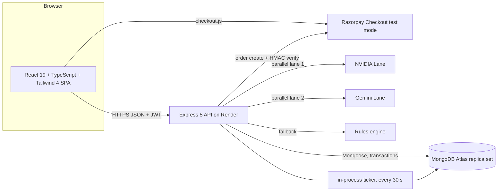
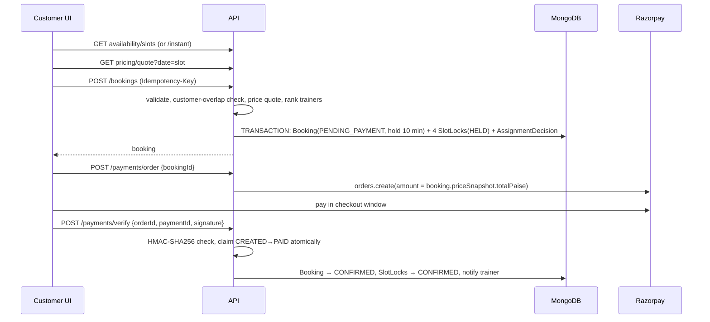

# Zuryo Fit — On-Demand Fitness Booking in Your Society / Apartment Gym (MVP)

A working, deployed MVP for booking a 60-minute personal-training session with a trainer in your residential society. It covers three role-based experiences in one app: **Customer**, **Trainer** and **Admin / Operations**.

> Built for the Zuryo Founding Full-Stack Engineer hands-on assignment. All data is **synthetic**. Payments use **Razorpay test mode only**. No real customer data or live credentials are used anywhere.

---

## 1. Live links and demo access

| Item | Link |
| :-- | :-- |
| Live app (frontend) | https://zuryo-fitness.netlify.app/ |
| Live API (backend) | https://zuryo-fitness-app.onrender.com/api (health check: `/api/health`) |
| GitHub repository | https://github.com/Manish-Yadav77/Zuryo_Fitness_App |
| Video walkthrough | https://drive.google.com/file/d/1wxDh-vC9TAty_5eFy9P0ZOsHXw316YcI/view?usp=sharing |

> **Cold start:** the backend is on a free Render instance, which sleeps after about 15 minutes without traffic and takes roughly 30–60 seconds to wake. If the first login is slow, open `/api/health` once and retry.

The product fits Zuryo's idea that any trainer can continue a customer's training because the fitness assessment is versioned and every session record is saved centrally.

### Demo accounts (password for every account: `Demo@12345`)

| Role | Email | What to try |
| :-- | :-- | :-- |
| Customer | `customer@demo.test`, `customer2@demo.test`, `customer3@demo.test` (also `customer4@…`, `customer5@…`) | Fitness profile, instant and scheduled booking, price breakdown, Razorpay test payment, packages, history, AI workout |
| Trainer | `trainer1@demo.test`, `trainer2@demo.test`, `trainer3@demo.test` (also `trainer4@…`, `trainer5@…`) | Assigned sessions, mark on the way, start and complete session with live timer, availability and time off, workout log |
| Admin | `admin@demo.test` | All bookings, assignment decisions (why each trainer was or was not chosen), pricing rules editor |

The login page also has one-click demo-account buttons for Customer, Trainer and Admin.

### Razorpay test payment

The app only runs against Razorpay **test** keys. In the Razorpay checkout window use the test card number `4111 1111 1111 1111`, any future expiry and any CVV (or the test UPI id `success@razorpay`). See Razorpay's test-mode documentation for the current list of test instruments. No real money moves.

---

## 2. What is implemented, partial and proposed

**Legend:** ✅ implemented and working · 🟡 partially implemented (what is missing is stated) · 📝 proposed only (design in section 14)

### A. Booking and trainer assignment

| Requirement | Status | Notes |
| :-- | :-- | :-- |
| Instant booking (starts within 60 min) | ✅ | Start times are offered every 15 minutes from now+10 min up to now+60 min. The server re-validates. |
| Scheduled booking | ✅ | Up to 30 days ahead, at least 10 minutes in advance. |
| Display available slots | ✅ | 15-minute start grid, 60-minute sessions, per-slot count of available trainers. Evaluated in India time (+05:30). |
| Trainer availability + no overlap | ✅ | Weekly hours + time-off blocks + per-15-minute `SlotLock` documents with a unique index. |
| Auto-assign by availability and service zone | ✅ | Zone match, working hours, time off, no lock. Ranked by distance, then load, then rating. |
| Preferred trainer | ✅ | Honoured only if that trainer is eligible for the slot. Otherwise falls back to auto-assign (`preferredHonored=false` is stored). |
| Notify trainer on assigned / cancelled / rescheduled | 🟡 | In-app notifications stored in MongoDB and shown in a bell, polled every 10 seconds. **No push, SMS, email or WhatsApp yet** (proposed). |
| Customer and trainer views update on change | 🟡 | Live timer syncs every 5 s and notifications every 10 s. Booking lists refresh on page load and after actions, not via WebSocket push. |
| No trainer available | ✅ | API returns `409 NO_TRAINER_AVAILABLE` and the decision is logged for admin. Slot grid shows an empty state. |
| Simulated GPS and ETA explanation | ✅ / 📝 | Seeded society and trainer coordinates + Haversine distance are implemented. Live GPS and ETA are explained in section 14. |
| Reschedule | ✅ | Customer UI includes a reschedule button in My Bookings with an inline datetime picker (available for CONFIRMED bookings). Re-assigns an available trainer and updates slot locks (max 2 reschedules, at least 2 hours before start). |

### B. Pricing and checkout

| Requirement | Status | Notes |
| :-- | :-- | :-- |
| Normal ₹399, peak ₹499, 10% commission | ✅ | Normal: 399.00 + 39.90 = **438.90**. Peak: 499.00 + 49.90 = **548.90**. |
| Breakdown shown before payment | ✅ | `PriceBreakdownCard` on the booking page and breakdown on the booking detail page. |
| Peak detection explained | ✅ | Configurable windows in India time (section 6.6). |
| Configurable, not hardcoded | ✅ | `PricingConfig` document, editable by admin in the UI, versioned. |
| Client cannot tamper with the amount | ✅ | Client sends only the slot time. Price is computed on the server, snapshotted on the booking, and the Razorpay order amount is read from that snapshot. |
| Payment sandbox | ✅ | Razorpay test mode with server-side HMAC signature verification. |

### C. Session timer and buzzer

| Requirement | Status | Notes |
| :-- | :-- | :-- |
| 60-minute session, start, 55-minute warning, 60-minute completion | ✅ | Server stores `startedAt`, `warnAt` (+55 min), `endsAt` (+60 min). A background job fires warning and completion. |
| Visible timer for trainer, clear status for customer | ✅ | Same timer card for both; status badges across the app. |
| Backend is authoritative | ✅ | Frontend only displays what `GET …/session/ticker` returns and re-syncs every 5 s. |
| "Buzzer" | ✅ | The notification bell plays an audio beep (Web Audio API) when a new unread notification arrives during the 10-second poll. The 55-minute warning notification therefore beeps if the page is open (browser autoplay rules may block it until user interaction). An amber banner shows when 5 minutes or less remain. |

### D. Packages and history

| Requirement | Status | Notes |
| :-- | :-- | :-- |
| Package model; purchased / used / remaining | ✅ | Three templates (5, 10, 20 sessions). Bought through Razorpay test checkout. |
| Upcoming, completed, cancelled bookings | ✅ | My Bookings tabs: Upcoming, Active, Completed, Cancelled/Expired. |
| No double deduction on retries | ✅ | Unique ledger entry per booking and type, conditional atomic update, transaction. |
| Cancelled sessions and refunds affect balance | 🟡 | Package credit restore is real and idempotent. **The money refund is simulated**: the payment is marked `REFUNDED` with a demo refund id; the Razorpay refund API is not called (section 6.6). |

### E. Fitness profile and session records

| Requirement | Status | Notes |
| :-- | :-- | :-- |
| Structured assessment (age, weight, goals, level, preferences) | ✅ | Versioned: every save creates a new version, history is kept. Also stores limitations, society, flat number, phone. |
| Structured session record | 🟡 | Duration, exercises (sets, reps, weight), trainer notes, suggested next workout, customer rating and feedback are all stored. **The trainer form logs one exercise per save**; the database model supports many. |
| Recommendation from assessment + history | ✅ | See the AI feature (section 7). |

### F. One working AI feature

| Requirement | Status | Notes |
| :-- | :-- | :-- |
| Personalised workout recommendation | ✅ | Dual parallel lanes (NVIDIA and Gemini) with `Promise.any` racing. First valid JSON wins; fallback to deterministic rules. Temperature 0.2, in-flight request deduplication, IPv4-first DNS configuration. Source, model, and latency returned and displayed in the UI. |
| Chatbot | 📝 | Not implemented (nutrition chatbot is a proposal). |

### Other

| Item | Status |
| :-- | :-- |
| Auth + role-based authorization (customer / trainer / admin) | ✅ |
| Input validation (Zod) and consistent error format | ✅ |
| Automated tests | ✅ 35 passing (unit + HTTP security). **No database-backed integration tests yet** (section 11). |
| Admin console (bookings, assignment decisions, pricing, revenue breakdown) | ✅ (revenue counts CONFIRMED, ON_THE_WAY, IN_PROGRESS and COMPLETED bookings; package cash from PAID payments; no trainer IDs in table) |
| Push notifications, live GPS/ETA, surge pricing, chatbot, ratings aggregation, payouts, etc. | 📝 |

---

## 3. Quick start (local)

**Prerequisites:** Node.js 22 LTS (20.19+ minimum for the Vite 8 toolchain), npm, and a MongoDB **replica set** (a free MongoDB Atlas cluster works; transactions require a replica set, a plain standalone `mongod` will not work). Note that the root `README.md` is the primary reference for this repository.

```bash
# 1) Backend
cd Backend
npm install
cp .env.example .env          # then edit values, see table below
npm run seed                  # WARNING: wipes and recreates all collections
npm run dev                   # http://localhost:5000/api/health

# 2) Frontend (new terminal)
cd Frontend
npm install
cp .env.example .env          # VITE_API_URL=http://localhost:5000/api
npm run dev                   # http://localhost:5173

```

### Environment variables (Backend)

| Variable | Required | Purpose |
| --- | --- | --- |
| `MONGODB_URI` | yes | Atlas connection string (replica set) |
| `JWT_SECRET` | yes | at least 32 characters; app refuses to start otherwise |
| `JWT_EXPIRES_IN_SECONDS` | no | default 43200 (12 h) |
| `CLIENT_ORIGIN` | yes in prod | comma-separated allowed browser origins (CORS) |
| `RAZORPAY_KEY_ID`, `RAZORPAY_KEY_SECRET` | required when `NODE_ENV=production` | Razorpay **test** keys |
| `NVIDIA_API_KEY`, `NVIDIA_MODEL`, `NVIDIA_BASE_URL` | optional | NVIDIA lane configuration |
| `LLM_API_KEY`, `LLM_MODEL` | optional | Gemini lane configuration (default `gemini-1.5-flash`) |
| `SEED_PASSWORD` | no | password given to seeded demo users (default `Demo@12345`) |

All variables are validated with Zod at start-up (`src/config/env.ts`). Invalid or missing values stop the server with a readable message. Real secrets live only in `.env` (git-ignored) or the hosting dashboard. `.env.example` contains placeholders only.

### Environment variables (Frontend)

| Variable | Purpose |
| --- | --- |
| `VITE_API_URL` | Backend base URL including `/api` |
| `VITE_RAZORPAY_KEY_ID` | Fallback Razorpay test key id (the backend also returns the key id with each order) |

### Scripts

| Where | Command | What it does |
| --- | --- | --- |
| Backend | `npm run dev` | `tsx watch` with `.env` |
| Backend | `npm run build` / `npm start` | compile to `dist/` and run |
| Backend | `npm run seed` | reset and seed synthetic data |
| Backend | `npm run migrate-pricing` | writes default peak windows into an existing pricing document |
| Backend | `npm test` | Vitest, 35 tests |
| Backend | `npm run typecheck` | `tsc --noEmit` |
| Frontend | `npm run dev` / `npm run build` / `npm run lint` | Vite dev server, type-check + build, ESLint |

---

## 4. Deployment

| Part | Host | Settings |
| --- | --- | --- |
| Database | MongoDB Atlas (M0 free cluster) | Create a database user, allow network access, copy the connection string into `MONGODB_URI`. |
| Backend | Render (Web Service) | Root directory `Backend` · Build `npm install && npm run build` · Start `npm start` · set the environment variables above · `NODE_ENV=production` · `CLIENT_ORIGIN=https://zuryo-fitness.netlify.app` |
| Frontend | Netlify | Base directory `Frontend` · Build `npm run build` · Publish `dist` · `VITE_API_URL=https://zuryo-fitness-app.onrender.com/api` · `public/_redirects` (`/* /index.html 200`) enables client-side routing |
| Seeding production | run locally | Put the Atlas URI in `Backend/.env` and run `npm run seed` once. Seed deletes existing data. |

Deploy flow: push to GitHub → Render and Netlify build automatically.

---

## 5. Architecture and stack (assignment §6.1)



| Layer | Choice | Why it fits this problem |
| --- | --- | --- |
| Frontend | React 19, TypeScript, Vite 8, Tailwind CSS 4, React Router 7, Axios, Lucide icons | Fast to build role-based dashboards; strict types shared between API client and pages; static hosting is free and fast. Responsive layout means one codebase for web and phones. |
| Backend | Node.js, Express 5, TypeScript (ESM), Zod | Same language end to end; Express 5 forwards async errors to one error handler; Zod validates every request body and the environment. |
| Database | MongoDB Atlas + Mongoose 9 | Bookings carry nested snapshots (price, session timestamps) that fit documents well; multi-document **transactions** (replica set) give us atomic booking + slot-lock + package consumption; TTL-free design keeps logic explicit. |
| Auth | JWT (HS256) + bcrypt (12 rounds) | Stateless API that is simple to deploy; role in the token, ownership checked per resource. |
| Payments | Razorpay (test mode) | Dominant in India (UPI, cards, netbanking); server-side order creation and signature verification. |
| AI | NVIDIA & Gemini parallel lanes → rules | Parallel racing with `Promise.any` and automatic fallback, guaranteeing fast responses and high reliability. |
| Tests | Vitest | Fast, TypeScript-native. |
| Hosting | Netlify (frontend), Render (backend), Atlas (database) | $0 to demonstrate; each can be upgraded independently. |

### Booking and payment flow



---

## 6. Technical document (assignment §6)

### 6.1 Stack

See section 5.

### 6.2 Data model and key APIs

**Collections** (Mongoose models in `Backend/src/models`):

| Collection | Key fields | Important indexes / constraints |
| --- | --- | --- |
| `User` | name, email, `passwordHash` (never selected by default), role (`customer`/`trainer`/`admin`), isActive | unique `email` |
| `Society` | name, `zoneId`, address, `location{lat,lng}`, commissionPercent, isActive | index `zoneId` |
| `CustomerProfile` | userId, societyId, flatNumber, phone | unique `userId` |
| `TrainerProfile` | userId, `zoneIds[]`, `baseLocation{lat,lng}`, rating, bio, `weeklyAvailability[{weekday,start,end}]`, `timeOff[{from,to,reason}]` | unique `userId` |
| `FitnessAssessment` | customerId, **version**, age, weightKg, goals[], level, preferences[], limitations | index (customerId, version desc) |
| `Booking` | customerId, trainerId, societyId, mode, startAt, endAt, status, paymentMode, packageId, **priceSnapshot**, preferredTrainerId, preferredHonored, idempotencyKey, holdExpiresAt, rescheduleCount, cancel fields, `session{startedAt,warnAt,endsAt,warnFiredAt,completeFiredAt}` | unique sparse (customerId, idempotencyKey) |
| `SlotLock` | trainerId, `atomStart` (15-min), bookingId, state (`HELD`/`CONFIRMED`), holdExpiresAt | **unique (trainerId, atomStart)** — the double-booking guard |
| `AssignmentDecision` | bookingId, slotStart, societyId, `candidates[]` (distance, load, rating, eligible, reason), chosenTrainerId, outcome (`ASSIGNED`/`NO_TRAINER`) | audit trail for admin |
| `Payment` | purpose (`BOOKING`/`PACKAGE`), bookingId or packageTemplateId, customerId, razorpayOrderId, razorpayPaymentId, amountPaise, status (`CREATED`/`PAID`/`FAILED`/`REFUNDED`), signatureVerified | unique `razorpayOrderId` |
| `PackageTemplate` | name, sessions, pricePaise, validityDays, isActive | — |
| `CustomerPackage` | customerId, templateId, packageName, totalSessions, usedSessions, expiresAt, paymentId | unique sparse `paymentId` (one package per payment) |
| `PackageLedger` | packageId, bookingId, type (`CONSUME`/`RESTORE`), sessionsCount | **unique (bookingId, type)** |
| `SessionRecord` | bookingId, customerId, trainerId, durationMinutes, exercises[], trainerNotes, suggestedNextWorkout, customerRating, customerFeedback | unique `bookingId` |
| `PricingConfig` | single document `_id:'default'`: normalPaise, peakPaise, commissionPercent, timezone, `peakWindows[]`, version | — |
| `Notification` | userId, type, bookingId, message, readAt | index `userId` |

All money is stored as **integer paise** (₹399 = `39900`).

**Booking status machine:** `PENDING_PAYMENT → CONFIRMED → ON_THE_WAY → IN_PROGRESS → COMPLETED`, with `CANCELLED` and `EXPIRED` (payment hold timed out) as exits. Package bookings skip `PENDING_PAYMENT` and start as `CONFIRMED`.

**Key APIs** (all under `/api`; JSON; errors look like `{ "error": { "code", "message", "details?" } }`):

| Area | Endpoint | Who |
| --- | --- | --- |
| Health | `GET /health` | public |
| Auth | `POST /auth/register`, `POST /auth/login`, `GET /auth/me` | public / any logged-in |
| Societies | `GET /societies` | public |
| Pricing | `GET /pricing/config`, `GET /pricing/quote?date=ISO`, `PUT /pricing/config` | public, public, **admin** |
| Assessment | `GET /assessments/me`, `POST /assessments` | customer |
| Availability | `GET /availability/slots?societyId&date&preferredTrainerId`, `GET /availability/instant?societyId`, `GET /availability/trainers?societyId&startAt` | logged-in |
| Bookings | `POST /bookings` (header `Idempotency-Key`), `GET /bookings`, `GET /bookings/:id` | customer, customer, owner/trainer/admin |
| Bookings (role lists) | `GET /bookings/assigned`, `GET /bookings/admin/all`, `GET /bookings/admin/assignments` | trainer, admin, admin |
| Cancel / reschedule | `POST /bookings/:id/cancel`, `POST /bookings/:id/reschedule` | customer or assigned trainer, customer |
| Session | `POST /bookings/:id/session/on-the-way`, `…/start`, `…/complete`; `GET /bookings/:id/session/ticker` | trainer; ticker for any party to the booking |
| Payments | `POST /payments/order`, `POST /payments/verify` | customer |
| Packages | `GET /packages/templates`, `GET /packages/mine` | public, customer |
| Records | `POST /records`, `GET /records/booking/:bookingId`, `GET /records/mine`, `POST /records/booking/:bookingId/feedback`, `GET /records/ai-recommendation` | trainer, party, customer, customer, customer |
| Trainer | `GET /trainer/me`, `PUT /trainer/availability`, `POST /trainer/time-off`, `DELETE /trainer/time-off/:id` | trainer |
| Notifications | `GET /notifications`, `PATCH /notifications/:id/read`, `POST /notifications/read-all` | logged-in |

### 6.3 How trainer assignment works (location and tie-breaking)

Code: `assignment.service.ts` (`findBestTrainerForSlot`, `rankCandidates`).

1. **Candidate pool:** all active trainers whose `zoneIds` contain the society's `zoneId`.
2. **Eligibility** for the requested 60-minute slot, evaluated per trainer, with a recorded reason:
* the slot lies inside one of the trainer's weekly working windows (evaluated in India time, so server timezone does not matter);
* the slot start is not inside a time-off block;
* none of the four 15-minute atoms of the slot is already locked for that trainer.


3. **Location:** distance in km between the society's coordinates and the trainer's base location using the **Haversine formula** (`utils/geo.ts`). Locations are seeded (simulated GPS).
4. **Preferred trainer:** if the customer picked one and that trainer is eligible, they win (`preferredHonored=true`). If not eligible, assignment silently falls back to ranking.
5. **Ranking (strict order, not a weighted score):**
1. smaller distance,
2. fewer sessions already booked that day (load balancing, evaluated in India time),
3. higher rating,
4. trainer id string order (a deterministic final tie-break so results are repeatable).


6. **Audit:** every attempt writes an `AssignmentDecision` containing all candidates, their distance, load, rating, eligibility and the reason for rejection, plus the chosen trainer or `NO_TRAINER`. Admin sees this in the console.
7. **No trainer:** the API returns `409 NO_TRAINER_AVAILABLE` (and logs a `NO_TRAINER` decision). The UI shows an error and the slot grid shows an empty state when nothing is available.

### 6.4 Preventing double booking and handling simultaneous requests

* Every session is split into four **15-minute atoms**. Booking inserts four `SlotLock` rows `(trainerId, atomStart)` inside one **MongoDB transaction** together with the `Booking` and `AssignmentDecision`.
* A **unique index** on `(trainerId, atomStart)` means that if two requests choose the same trainer for overlapping time, the database rejects the second insert (`E11000`). The transaction aborts and the API returns `409 SLOT_ALREADY_BOOKED`. Overlaps that are offset by 15 minutes still share at least one atom, so they collide too.
* **Payment hold:** card bookings are created as `PENDING_PAYMENT` with locks in state `HELD` and `holdExpiresAt = now + 10 min`. A background job marks unpaid bookings `EXPIRED` and deletes held locks. Payment verification only confirms a booking whose hold is still valid.
* **Idempotency:** the client sends an `Idempotency-Key` header. The server returns the existing booking for the same customer and key, and a unique sparse index backs this up.
* **Customer overlap:** a customer cannot hold two active bookings in overlapping time.
* **Honest note:** the front end generates a fresh key on every submit click, so protection against a user double-clicking comes from the customer-overlap check and the slot locks, not from the key alone. The key protects automatic retries that reuse it.

### 6.5 Session timers, reminders and status reliability

* **Authoritative times:** when the trainer starts a session, the server atomically moves the booking `CONFIRMED/ON_THE_WAY → IN_PROGRESS` and stores `startedAt`, `warnAt = +55 min`, `endsAt = +60 min` using the **server clock**. The conditional update means a double-click cannot start it twice.
* **Ticker endpoint:** `GET /bookings/:id/session/ticker` returns `serverTime`, `startedAt`, `endsAt`, `remainingSeconds` and flags. The browser sets its countdown from `remainingSeconds`, ticks locally each second for smoothness, and **re-syncs from the server every 5 seconds**.
* **Browser refresh:** nothing important lives in the browser. The page reloads and fetches the ticker again.
* **App closed:** state is in the database. A background ticker (`ticker.service.ts`, runs at boot and every 30 s) fires the 55-minute warning and the completion event exactly once, using conditional updates (`warnFiredAt` / `completeFiredAt`), so multiple server instances cannot double-fire.
* **Device clock differences:** the client never uses its own clock to decide state; it only counts seconds between server syncs. A wrong device clock cannot shorten or extend a session.
* **Delayed notifications:** warning and completion can be late by up to about 30 seconds (the ticker interval). The status is still correct because the ticker endpoint also **completes lazily on read** when `endsAt` has passed.
* **Known limitation:** on a free Render instance the process sleeps when idle, so background events pause until the next request. The warning is intentionally skipped if the server wakes after `endsAt`. Mitigations: always-on instance (about $7/month) or an external pinger on `/api/health`; production fix is a durable job queue (section 13).

### 6.6 Pricing, commission and package balances, securely

* **Rules live in the database** (`PricingConfig`): normal rate, peak rate, commission percent, peak windows (weekday list + start/end minute, **India time**), and a `version` that increments on every admin edit.
* **How peak is identified:** a slot is peak when its **start time** (converted to Asia/Kolkata) falls inside any peak window; start is inclusive and end exclusive. Defaults: weekdays 06:00–09:00 and 17:00–21:00, weekends 07:00–11:00. (`peak.ts`, `pricing.service.ts`)
* **Calculation:** `buildQuote` is a pure function working in integer paise. Commission = `round(session × percent×100 / 10000)`. Example normal: 39900 + 3990 = **43890**. Example peak: 49900 + 4990 = **54890**. 12.5% commission rounds to the nearest paisa (tested).
* **Snapshot:** the quote (tier, amounts, percent, config version) is stored on the booking, so later rule changes never alter an existing booking.
* **No client tampering:** the request body contains no amount. `POST /payments/order` reads `booking.priceSnapshot.totalPaise` and creates the Razorpay order from that. Package orders use the template's price from the database.
* **Payment verification:** `HMAC-SHA256(secret, orderId|paymentId)` compared with a constant-time function. Only one concurrent verify can move the payment `CREATED → PAID` (atomic conditional update). Repeating the same verify returns the same result and changes nothing.
* **Package balance:** a package is created only after a verified payment, and a unique index on `paymentId` guarantees **one package per payment**. Using a credit runs a conditional atomic update (`usedSessions < totalSessions`, not expired, soonest-expiring first) and writes a `PackageLedger` `CONSUME` row inside the booking transaction. The unique `(bookingId, type)` index means a booking can never deduct twice.
* **Cancellation and refunds (policy):** cancelling at least **2 hours** before start, or any cancellation made by the trainer, is eligible. For package bookings, a `RESTORE` ledger row is written and `usedSessions` decreases by one (also idempotent). For paid bookings the payment is marked `REFUNDED`. Cancelling inside 2 hours gives no refund or credit. Unpaid (`PENDING_PAYMENT`) bookings simply release their slot.
* **Simulated refund:** in this MVP the refund is recorded in the database only (`demo_refund_…` id). **Production:** call the Razorpay refund API with a stored refund id, confirm through webhook, and surface refund failures in `refundError`.
* **Commission on packages:** commission is added to single-session checkout as the assignment describes. Package bundles are sold at their listed bundle price with no extra commission (an assumption, see section 12).

### 6.7 Notifications, GPS and real-time ETA in production

**Implemented:** persisted in-app notifications (assigned, cancelled, rescheduled, on the way, session started, 55-minute warning, completed), shown in a bell with unread count and an audio beep (via Web Audio API) on arrival.

**Production design (proposed, section 14.1 and 14.2):** push through FCM/APNs and WhatsApp/SMS for reminders, delivered by a queue-backed worker; trainer app sends location pings over WebSocket or HTTPS to a location service; ETA from a routing API with traffic, recomputed on a schedule and on significant movement; customer receives updates over a WebSocket channel.

### 6.8 Authentication, authorization, secrets and privacy

* **Passwords:** bcrypt, 12 rounds; unknown-email logins compare against a dummy hash to keep response time similar (reduces user-enumeration by timing). Password rules: 8–72 characters with a letter and a number.
* **Tokens:** JWT signed with `JWT_SECRET` (at least 32 characters, enforced), 12-hour expiry, carrying only `sub` and `role`.
* **Roles:** public signup always creates a `customer`; trainers and admins exist only through the seed or admin tooling. Routes are guarded with `requireAuth` + `requireRole`.
* **Ownership (object-level authorization):** `assertCanViewBooking` lets only the owning customer, the assigned trainer or an admin read a booking, ticker or record. Others receive **404, not 403**, so booking ids cannot be probed.
* **Brute force:** login and register are rate-limited (30 attempts per 15 minutes per IP).
* **Transport and headers:** Helmet defaults; CORS allow-list from `CLIENT_ORIGIN`; JSON body limit 100 kB; `trust proxy` set for Render so rate limits see real client IPs.
* **Validation:** Zod on every body, ObjectId format checks on ids (malformed id returns a clean 404, tested).
* **Secrets:** only in environment variables (Render / local `.env`), validated at boot; the Razorpay secret and AI keys never reach the browser. `.env` is git-ignored.
* **Privacy:** synthetic data only. Personal data collected: name, email, phone, flat number, age, weight and a free-text limitations field. Production would add explicit consent, data minimisation, retention limits, encryption at rest (Atlas default) and a deletion workflow in line with India's DPDP Act 2023.
* **Known gaps:** token is kept in `localStorage` (XSS exposure; an httpOnly cookie is safer); `isActive` is re-checked only on `/auth/me`, so a deactivated user's token works until expiry on other routes; no refresh-token rotation; no global rate limit beyond auth.

### 6.9 Scaling plan

| Pressure | Change | Why |
| --- | --- | --- |
| More API traffic | Run several stateless API instances behind the host's load balancer | JWT is stateless; the ticker uses conditional updates so duplicates are safe |
| Availability queries are the heaviest read (a loop per slot per trainer) | Precompute availability per trainer/day, cache in Redis, batch the lock query into one `$in` query | Removes N+1 database calls |
| Background work (ticker, notifications) | Move to a queue (BullMQ + Redis or SQS) with delayed jobs scheduled at `warnAt` and `endsAt`, plus a separate worker service | Exact-time events, retries, no dependence on the API process staying awake |
| Real-time updates | Replace polling with WebSockets / Server-Sent Events (Socket.IO with Redis adapter) | Fewer requests, instant UI updates |
| Database growth | Atlas dedicated tier, read replicas for admin/reporting, archive old bookings, add indexes for new queries | Isolate analytics from booking writes |
| Many societies/cities | Zone-based sharding of assignment queries, geospatial index (`2dsphere`) on trainer location instead of loop + Haversine | Faster candidate search |
| Payments | Razorpay webhooks + reconciliation job | Handles browser-closed-after-payment cases |
| Observability | Structured logs, error tracking, uptime checks, metrics | Operate it reliably |

### 6.10 Cost estimate, drivers and trade-offs

See section 13.

---

## 7. The AI feature: personalised workout recommendation

**Endpoint:** `GET /api/records/ai-recommendation` (customer only). **Code:** `Backend/src/services/ai.service.ts`. **UI:** `AiRecommendationCard.tsx` on the customer dashboard.

**How it works**

1. Loads the customer's latest assessment and their last 5 session records.
2. Builds one prompt: role (certified fitness coach), profile (age, weight, goals, level, preferences, limitations), recent sessions (duration, exercises with sets and reps, rating, trainer notes, suggested next workout), and required JSON schema: `workoutTitle`, `focusArea`, `warmUp[]`, `mainCircuit[{exercise,sets,reps}]`, `coolDown[]`, `coachNote`.
3. Executes two parallel execution lanes in parallel using `Promise.any`:
* **NVIDIA Lane:** Tries configured NVIDIA models in sequence (e.g. `meta/llama-3.1-405b-instruct`, `meta/llama-3.1-70b-instruct`, `nvidia/nemotron-4-340b-instruct`).
* **Gemini Lane:** Tries configured Gemini models in sequence (e.g. `gemini-1.5-flash`).
* Each model attempt has a strict per-attempt time cap of 12–15 seconds.
* Temperature is set to `0.2`.
* Double-click protection shares a single in-flight request per customer.
* The JSON parser strips think-tags and code fences and validates all required fields. If a provider returns HTTP 400, it retries with a plain body format. IPv4-first DNS resolution is enforced in `config/network.ts`.
* `Promise.any` accepts the first valid JSON returned and aborts remaining requests via `AbortController`.
* The overall backend execution deadline is 35 seconds and the frontend timeout is 55 seconds.


4. If both parallel lanes fail or return invalid JSON, a **deterministic rules engine** provides a fallback workout plan.
5. The response includes `source` (`NVIDIA` / `GEMINI` / `RULES`), `model` and `latencyMs`, displayed in the UI badge.

| Item | Detail |
| --- | --- |
| Models | NVIDIA models from `NVIDIA_MODEL` / internal list; Gemini model from `LLM_MODEL` (default `gemini-1.5-flash`); rules engine fallback |
| Credentials | Server-side environment variables only |
| Approx. cost per interaction | Rules: $0. Gemini 1.5 Flash input and output pricing amounts to **<$0.002 per recommendation**. NVIDIA's hosted catalog is free for prototyping. Because both lanes execute in parallel for each request, both lanes may consume free-tier quota on a single click. These are estimates, not billing data. |
| Latency | Rules: a few milliseconds. Parallel LLM calls return as soon as the fastest valid lane finishes. Measured in the UI badge — see table below. |
| Limitations | Both lanes may consume free-tier quota on a single click; output is not validated against a schema beyond `JSON.parse`; no medical-safety layer (limitations text is passed to the model but the plan is not clinically checked); user-entered text is placed inside the prompt; recommendations are not stored. |

**Measured latency (fill from the badge on the dashboard before submitting):**

| Run | Source shown | Latency (ms) |
| --- | --- | --- |
| 1 | Gemini | 11935ms |
| 2 | Nvidia | 14735ms |
| 3 | Rule | 16449ms |

**Implemented vs. proposed:** the recommendation above is implemented. The nutrition chatbot and "no-trainer-day" daily workouts are proposals (section 14).

---

## 8. Requirement-to-code map

| Assignment item | Where it lives |
| --- | --- |
| Slots display | `availability.controller.ts` → `slots.service.ts`; UI `SlotGrid.tsx`, `BookPage.tsx` |
| Assignment | `assignment.service.ts`, `AssignmentDecision.ts`; admin view in `AdminDashboard.tsx` |
| Booking creation, locks, hold | `booking.service.ts`, `SlotLock.ts`, `Booking.ts` |
| Cancel / reschedule | `cancellation.service.ts` |
| Pricing and peak | `pricing.service.ts`, `peak.ts`, `PricingConfig.ts`; admin UI `PricingPage.tsx` |
| Payments | `payment.service.ts`; UI in `BookingDetailPage.tsx`, `PackagesPage.tsx`, `lib/razorpay.ts` |
| Timer | `session.service.ts`, `ticker.service.ts`; UI `SessionTimerCard.tsx` |
| Packages | `package.service.ts`, `CustomerPackage.ts`, `PackageLedger.ts` |
| Assessment and records | `assessment.service.ts`, `record.controller.ts`; UI `AssessmentPage.tsx`, `SessionRecordForm.tsx`, `HistoryPage.tsx` |
| AI | `ai.service.ts` |
| Notifications | `notification.service.ts`; UI `NotificationBell.tsx` |
| Auth and RBAC | `auth.controller.ts`, `middleware/auth.ts`, `utils/jwt.ts`, `utils/ownership.ts`; UI `AuthProvider.tsx`, `ProtectedRoute.tsx` |

---

## 9. Repository layout

```
Zuryo_Fitness/
├── Backend/
│   └── src/
│       ├── app.ts                 Express app: helmet, cors, json limit, /api routes, error handlers
│       ├── index.ts               boot: connect DB, start ticker (30 s), listen
│       ├── config/                env.ts (Zod-validated env), db.ts (Mongoose connect), network.ts
│       ├── controllers/           HTTP layer: parse + validate (Zod) → call service → respond
│       ├── routes/                URL → middleware → controller wiring (index.ts mounts all)
│       ├── services/              business logic (assignment, booking, cancellation, payment, pricing, peak, session, slots, ticker, package, ai, notification, assessment, availability, time)
│       ├── models/                Mongoose schemas
│       ├── middleware/            auth.ts (JWT + roles), error.ts (uniform errors)
│       ├── utils/                 AppError, geo (Haversine), ids, jwt, ownership, timeFormat (IST)
│       ├── seed/                  seed.ts (synthetic data), migrate-pricing.ts
│       └── tests/                 7 Vitest files, 35 tests
└── Frontend/
    └── src/
        ├── api/                   one Axios module per backend area + client.ts (JWT, 401 handling, error parsing)
        ├── components/            ai, auth (route guards), booking, layout (shell, bell), pricing, records, session, ui primitives
        ├── config/                env.ts, nav.ts (role navigation)
        ├── context/ hooks/        AuthProvider + useAuth
        ├── lib/                   money (paise→₹), time (IST formatting), razorpay loader, storage, validation
        ├── pages/                 auth, customer, trainer, admin
        ├── routes/AppRoutes.tsx   role-protected route tree
        └── types/                 API response types

```

---

## 10. UI / UX coverage (assignment §4)

Customer journey: login (demo buttons) → fitness profile → choose Instant or Scheduled → choose slot in your society / apartment gym → optional preferred trainer → price breakdown → choose Razorpay or package credit → booking confirmation page → status and history. Trainer: dashboard of assigned sessions with customer name, flat number and society address, timing, status actions, and workout logging; availability and time-off page. Admin: metrics, all bookings, assignment decisions and pricing editor.

### Evolving to React Native

* Keep the backend and API contract unchanged; move shared pieces (API client, types, Zod schemas, money/time helpers) into a shared package used by web and mobile.
* Rebuild screens with React Native + Expo; navigation with React Navigation mirroring the role route tree; replace Tailwind with NativeWind or a small design-token layer.
* Store the JWT in the platform secure store (Keychain/Keystore) instead of `localStorage`.
* Add what only mobile can do: FCM/APNs push, background location for trainers, native Razorpay SDK, haptic/audio buzzer at 55 and 60 minutes, deep links from notifications.

---

## 11. Testing

```bash
cd Backend
npm test

```

**Latest result (local run):** 7 test files, **35 tests passed**, 0 failed, about 20 seconds.

| File | Tests | What it proves |
| --- | --- | --- |
| `pricing.test.ts` | 11 | Peak boundaries (start inclusive, end exclusive), weekday/weekend windows, India time vs UTC; normal ₹399 → 438.90, peak ₹499 → 548.90, 12.5% rounding, 0% commission, config version carried |
| `assignment.test.ts` | 4 | Closest eligible first, preferred honoured when eligible, fallback when not, no trainer when all ineligible |
| `availability.test.ts` | 4 | Ranking and tie-breaks (distance, then load) and preferred-trainer rules (**the file name says availability but it exercises the ranking function**) |
| `payment.signature.test.ts` | 5 | Valid HMAC accepted; empty, short, wrong-secret, wrong-payment-id, wrong-order-id and the old bypass string rejected |
| `ownership.test.ts` | 4 | Customer/trainer/admin visibility, role mix-ups, 404 not 403 |
| `http-security.test.ts` | 6 | Removed free-package endpoint returns 404; protected routes return 401 without a token; validation returns 400; malformed ids return 404; customers get 403 on admin/trainer routes (runs the real Express app, no database) |
| `concurrency.test.ts` | 1 | **Weak:** it only constructs two lock documents with the same key. It does not hit a database, so it does **not** prove the unique index rejects a duplicate. The protection itself is the unique index plus transaction described in 6.4. |

**Not yet covered (honest list):** database-backed integration tests for booking concurrency, cancellation and refunds, package ledger idempotency, timer/ticker transitions and AI fallback ordering. Next step: run these against an in-memory MongoDB replica set in CI.

---

## 12. Assumptions and known limitations

**Assumptions**

* Currency INR; all business rules evaluated in India Standard Time.
* Society commission is added to single-session checkout; packages are sold at bundle price without extra commission.
* Trainer locations are fixed seeded base points; there is no live GPS.
* Cancellation policy: free cancellation/credit restore at least 2 hours before start; trainer-initiated cancellation always refunds.

**Known limitations**

1. Refunds are simulated in the database (no Razorpay refund API call).
2. No Razorpay webhook. If a customer pays but closes the browser before `/payments/verify`, the booking can expire while the payment stays captured. Production needs webhook handling plus an auto-refund/reconciliation job. Likewise, a verified payment arriving after the hold expired marks the payment `FAILED` without refunding.
3. Reschedule keeps the original price snapshot (no re-pricing), does not validate that the new time is in the future or within 30 days, deletes and re-inserts locks outside a transaction, and UI errors are logged only to the console.
4. The trainer may start a session at any time once it is `CONFIRMED` (no check against the scheduled start window) and there is no no-show handling.
5. Background ticker runs inside the API process: it pauses when a free instance sleeps; events can be late by up to 30 s.
6. Expired payment holds keep blocking a slot until the ticker releases them (up to about 30 s after expiry).
7. The trainer workout form saves one exercise per submit (a later save replaces earlier exercises); the data model supports many.
8. `Society.commissionPercent` exists in the schema but pricing uses the single global commission from `PricingConfig`.
9. Several availability queries loop per slot per trainer (N+1 query pattern).
10. Token in `localStorage` (XSS risk).
11. `isActive` is checked only on `/auth/me`.
12. No refresh tokens.
13. Tests: unit and HTTP-security only; no DB integration tests and the concurrency test is a placeholder.
14. `routes/ticker.routes.ts` is an empty mounted router (dead code); the real ticker endpoint is `GET /bookings/:id/session/ticker`.
15. Trainer rating is static and not recalculated from feedback.
16. Invalid ObjectIds on some routes return 500 instead of 404.
17. `verify-payment` retry on an already confirmed booking returns `HOLD_EXPIRED`.

---

## 13. Cost estimate and scaling plan (assignment §6.10, §8.9)

### Today: $0 per month

| Component | Plan used | Cost |
| --- | --- | --- |
| Frontend | Netlify free plan | $0 |
| Backend | Render free web service (sleeps when idle) | $0 |
| Database | MongoDB Atlas M0 (512 MB, shared) | $0 |
| Payments | Razorpay test mode | $0 (no real money) |
| AI | NVIDIA free hosted catalog (prototyping) + Gemini free tier + rules | $0 |

### What it would cost as bookings grow

Prices below were checked in October 2026 against provider pricing pages and are **rough planning figures**, not quotes. Check the live pricing pages before committing.

Assumptions: average booking value ≈ ₹500 including commission; one AI recommendation per about 1 in 3 bookings; ≈ ₹85–90 per US dollar.

| Stage | Bookings / month | Frontend | Backend | Database | AI | Other | Infra total (approx.) |
| --- | --- | --- | --- | --- | --- | --- | --- |
| Demo (now) | tens | $0 | $0 | $0 | $0 | – | **$0** |
| Pilot (1–2 societies) | ~100 | $0 | Render Starter $7 (always on, so timers and ticker work) | Atlas M0 $0 (or Flex ≈$8) | < $1 | uptime pinger $0 | **≈ $7–16** |
| Early traction | ~1,000 | $0–9 | Render Starter/Standard $7–25 | Atlas Flex $8–30 | $2–5 | push (FCM) $0, SMS/WhatsApp pay-per-message | **≈ $25–75** |
| Growth | ~10,000 | Netlify Pro ≈$20 | 2 × Standard $50 + worker $7–25 | Atlas M10 ≈$58 + backups | $20–50 | Redis ≈$10–30, monitoring $0–30, routing/ETA API usage | **≈ $200–300** |
| Scale | ~100,000 | Pro-tier CDN | 3–4 × Pro ≈$255–340 (or move to AWS) | Atlas M30 ≈$394+ replicas/backups | $200–500 | Redis/queue $50–150, maps/ETA $300+, monitoring ≈$100 | **≈ $1,200–2,500** |

**Variable cost that outgrows infrastructure: payment gateway.** Razorpay's standard domestic rate is 2% plus 18% GST on that fee, an effective **2.36% of every payment**. At ₹500 average that is about ₹11.80 per booking: ≈ ₹1,180 at 100 bookings, ≈ ₹1.18 lakh at 10,000, ≈ ₹11.8 lakh at 100,000 — larger than all the infrastructure combined by 10,000 bookings. Levers: UPI-first checkout, selling packages (one payment covers many sessions), volume-negotiated rates, and any current new-merchant promotions.

### Major cost drivers and trade-offs

| Decision | Cheap option | Costlier option | Trade-off |
| --- | --- | --- | --- |
| Backend always-on | Free sleeping instance | $7+ always-on | Free breaks timers and first-request latency; $7 is the best early upgrade |
| Database | Atlas M0/Flex | M10+ dedicated | M0 has no backups/SLA and about 100 ops/sec; dedicated adds backups, headroom, replicas |
| Real-time | Polling every 5–10 s | WebSockets + Redis | Polling is trivial and cheap at small scale; sockets cut request volume and lag later |
| Background jobs | In-process interval | Queue + worker | Interval is free but fragile; queue costs ≈$10–50 and gives exact timing and retries |
| AI | Rules + free tiers | Paid LLM primary | NVIDIA's free catalog is explicitly for prototyping and rate-limited, so a paid provider is the honest production choice (cents per thousand calls) |
| Maps / ETA | Straight-line estimate | Routing API with traffic | Usage-billed; enable only for bookings in the final hour |
| Messaging | In-app + push (free) | WhatsApp/SMS | Push is free; WhatsApp/SMS are per message but reach people who have the app closed |

---

## 14. Design proposals (assignment §7)

Detailed designs for **three** features (live location and ETA, surge pricing, push/reminders), then shorter designs for the rest and for market-specific ideas.

### 14.1 Live trainer location and arrival ETA *(detailed)*

**UX:** After "On the way", the customer sees a map pin and "Arriving in 7 min"; the trainer app shows a "Share my location" indicator. Location sharing starts at "On the way" and stops at "Start session".

**Architecture:** trainer mobile app sends a ping every 10–15 s (HTTPS or WebSocket) → location service validates and stores the latest point in Redis (`GEOADD`/hash with TTL) → ETA worker calls a routing API (Google Distance Matrix / Mapbox / Ola Maps) at most every 30–60 s or when the trainer moves more than a threshold → pushes `eta:update` to the customer over a WebSocket channel (fallback: polling `GET /bookings/:id/tracking`).

**APIs**

* `POST /trainer/location` `{ bookingId, lat, lng, accuracy, heading, ts }` → `204`
* `GET /bookings/:id/tracking` → `{ trainerLocation, etaSeconds, distanceMeters, updatedAt, status }`
* WebSocket event `tracking:update` (room per booking, authorised by booking ownership)

**Data model changes:** `Booking.tracking { active, lastLocation{lat,lng,ts}, etaSeconds, etaUpdatedAt }`; a short-lived `LocationPing` collection with a TTL index (24–72 h) for dispute review; consent flag on `TrainerProfile`.

**Dependencies:** native background-location permission (iOS/Android), routing API key, Redis, WebSocket server, battery-friendly update policy.

**Edge cases:** GPS drift or stale pings (drop points older than 60 s, show "last seen"); trainer offline (fall back to scheduled ETA and notify support after N minutes); mock-location spoofing (check accuracy, speed plausibility, optional geofence check at "Start session"); privacy (share only during the active window, never after the session, delete pings on schedule); poor routing results inside gated societies (use gate coordinates as destination); API cost control (throttle by time and distance); customer reschedules mid-trip.

### 14.2 Sophisticated peak and surge pricing *(detailed)*

**Goal:** price from demand and lead time, not just fixed windows, while staying predictable and capped.

**Inputs:** time-of-day windows (already implemented), **lead time** (instant bookings cost more), **demand ratio** = open bookings ÷ available trainer capacity for that zone and hour, day type (weekend/festival/rain), trainer scarcity.

**Formula (example):** `price = base(tier) × clamp(1 + a·(demandRatio−0.7)⁺ + b·instantFlag, 1.0, 1.5)`, rounded to ₹5 or ₹10, then commission as today. Caps and floors come from config; the multiplier is **frozen into the booking's price snapshot at quote time** and honoured for the 10-minute payment hold.

**APIs**

* `GET /pricing/quote?slot=…&societyId=…` → returns tier, multiplier, reasons (`["PEAK_WINDOW","HIGH_DEMAND"]`), and `quoteId` + `expiresAt`
* `PUT /pricing/surge-config` (admin): cap, thresholds, per-zone overrides, on/off
* `POST /bookings` accepts `quoteId`; server rejects expired or mismatched quotes

**Data model changes:** `PricingConfig.surge { enabled, maxMultiplier, demandThresholds[], leadTimeRules[], zoneOverrides[] }`; `Quote` collection (id, slot, society, multiplier, reasons, expiresAt) or signed quote token; `DemandSnapshot` (zone, hour, bookings, capacity) written by a scheduled job; `Booking.priceSnapshot.multiplier, reasons[]`.

**Dependencies:** accurate capacity per zone/hour (from availability), a scheduled aggregation job, admin analytics, clear UI copy ("Higher demand right now").

**Edge cases:** price changes between quote and pay (quote locking with expiry); fairness and trust (show the reason, hard cap, no surge for existing packages' credits); gaming (users toggling slots to find cheaper prices — rate limit quotes); regulatory/consumer-protection expectations around transparent pricing; interaction with discounts, promos and package credits (credits never surge); cancellations after surge (refund the snapshot price); data cold-start (fall back to window-based pricing).

### 14.3 Push notifications, reminders and offers *(detailed)*

**UX:** reminders 24 h and 30 min before a session; "trainer assigned / on the way / arrived"; 55-minute warning and completion even when the app is closed; rebooking nudges after a completed session; offers only with consent and quiet hours.

**Architecture:** event → `NotificationService.enqueue()` → queue (BullMQ/Redis) with **delayed jobs** (scheduled at `startAt − 30 min`, `warnAt`, `endsAt`) → worker picks channels by preference and fallback order (push → WhatsApp → SMS) → provider adapters (FCM/APNs, WhatsApp Business API, SMS) → delivery receipts update the `Notification` record. Jobs are cancelled or re-scheduled when a booking is cancelled or rescheduled.

**APIs**

* `POST /devices` `{ token, platform }` (register/refresh push token); `DELETE /devices/:id`
* `GET/PUT /notification-preferences` (channels, quiet hours, offers opt-in)
* Existing `GET /notifications` continues to power the in-app bell

**Data model changes:** `DeviceToken(userId, token, platform, lastSeenAt)`; `NotificationPreference(userId, channels, quietHours, marketingOptIn)`; `Notification` gains `channel`, `status` (`QUEUED/SENT/DELIVERED/FAILED`), `dedupeKey`, `scheduledFor`; `Campaign` for offers.

**Dependencies:** Firebase project and APNs keys, WhatsApp Business account and approved templates, queue and worker, consent records.

**Edge cases:** duplicate sends (dedupe key per booking+event); user changes time (cancel/reschedule jobs); invalid or expired tokens (prune on provider error); quiet hours and time zones; delivery after the event is stale (drop the warning if `endsAt` has passed); provider outage (retry with backoff, switch channel); spam and consent for offers; rate limits.

### 14.4 Other proposals (shorter)

| Feature | Approach |
| --- | --- |
| Preferred-trainer selection and availability (extend) | "Favourite trainers" list per customer; `GET /trainers/:id/availability`; booking form filters slots to that trainer; waitlist and notify when a favourite frees up; guard fairness so one trainer is not overloaded (load cap per day) |
| Trainer/customer feedback and ratings | Two-way ratings after completion; rolling `TrainerProfile.rating` computed from `SessionRecord.customerRating` with minimum-sample smoothing; trainer rates customer punctuality privately; moderation and abuse flags; low-rating alerts to admin; rating feeds assignment tie-break (already supported) |
| Workout recommendations on days without a booking | Scheduled job (or on app open) generates a short home workout from the latest assessment, recent sessions and the days since last session; cache per user per day to control cost; push nudge at the customer's usual time |
| Nutrition recommendation chatbot | Scoped assistant (RAG over vetted nutrition content, hard refusal for medical/diagnosis topics, allergy and limitation awareness), conversation and token budgets per user, safety disclaimer, escalation to a human dietitian; server-side keys; cost = tokens per message |
| Progress tracking | Charts from versioned `FitnessAssessment` (weight, goals over time) and `SessionRecord` (volume, consistency, personal bests); streaks and milestones; periodic re-assessment prompts; export to PDF |

### 14.5 Market- and geography-specific ideas (India)

* **UPI-first checkout and UPI AutoPay** for subscriptions/package renewals; Razorpay Route for **automatic split payouts** to trainers and society/RWA commission.
* **WhatsApp Business notifications** (high open rates in India) with regional-language templates (Hindi, Kannada, Tamil, Marathi, etc.) and in-app language switch.
* **Society integration:** gate entry pre-approval through visitor-management systems used by gated communities (e.g., MyGate, NoBrokerHood, ADDA), society admin dashboard, RWA commission statements, clubhouse/gym-room booking inside the society.
* **Trust and safety:** trainer KYC and background verification, verified badge, SOS button and trip-sharing during sessions, option to request a female trainer, session check-in code at the door.
* **Compliance:** GST-compliant invoices for each payment and commission line, DPDP Act 2023 consent and data-deletion flows (health data sensitivity), clear refund policy surfaced at checkout.
* **Local conditions:** monsoon/traffic-aware ETA buffer for cities like Bengaluru, mobile-data-light UI, offline-tolerant timer (cache last server offset), low-end Android performance budget.
* **Growth and retention:** society-wise launch and group classes, referral credits, corporate-wellness bundles for residential-office communities, festival/season packages, wearable sync (Google Fit/Apple Health) to enrich recommendations.

---

## 15. Submission checklist (assignment §8)

| # | Item | Where |
| --- | --- | --- |
| 1 | Live URL | Section 1 |
| 2 | GitHub URL | Section 1 |
| 3 | Demo access | Section 1 |
| 4 | README with setup and deployment | Sections 3 and 4 |
| 5 | Architecture and schema | Sections 5, 6.2 |
| 6 | Test instructions and results | Section 11 |
| 7 | Screen recording | Section 1 (video link) |
| 8 | Implemented / partial / proposed list | Section 2 |
| 9 | Cost estimate and scaling plan | Sections 6.9, 13 |
| 10 | What I would build next and why | Section 16 |

---

## 16. What I would build next, and why

1. **Razorpay webhooks + real refunds + reconciliation.** Money correctness is the highest risk: today a closed browser tab between payment and verification can leave a paid but unconfirmed booking.
2. **Durable job queue for timers and notifications**, plus push/WhatsApp reminders. The timer is correct on read, but alerts must arrive on time even when the server restarts or sleeps.
3. **Database-backed integration tests** (booking concurrency, cancellation/refund, package ledger, ticker) in CI, so the guarantees in section 6 are proven automatically.
4. **Start-window rules for trainers, no-show handling, multi-exercise workout logging, per-society commission.** These close the remaining functional gaps listed in section 12.
5. **Live location and ETA**, then **demand-based pricing**, which are the features that change customer experience and revenue most.
6. **React Native app** for background GPS, native push and the audible buzzer.

---

*All names, emails, phone numbers, weights and workouts in this project are synthetic. No real customer information, production credentials or paid services are used.*